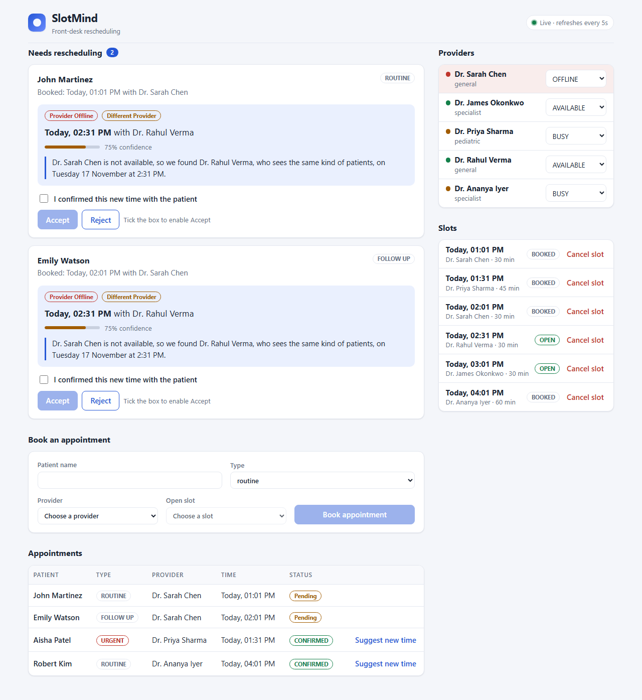
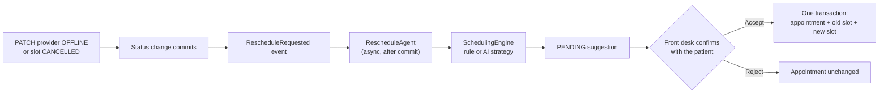
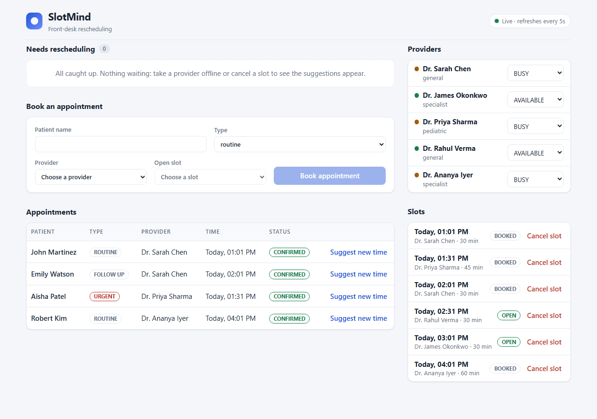
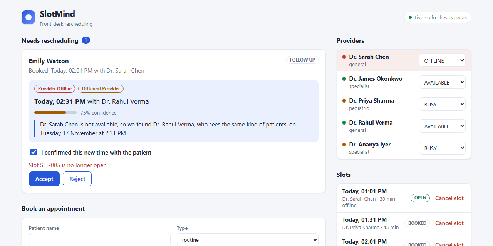
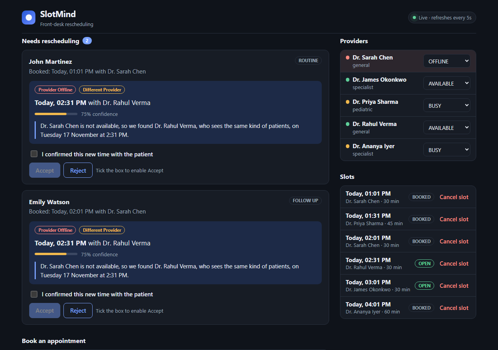
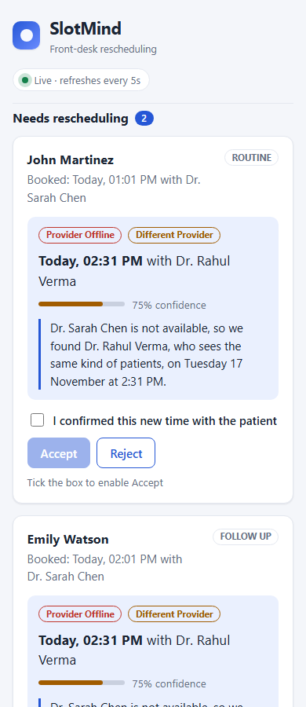

# SlotMind

**A reactive re-scheduling engine for clinic front desks.** When a provider goes offline or a slot is
cancelled, SlotMind finds the affected appointments, proposes new slots (rule-based or AI), and
queues each proposal for front-desk approval. Nothing changes until a person confirms it with the
patient.


<p align="center">
  
</p>

## Contents

- [Features](#features)
- [How it works](#how-it-works)
- [Screenshots](#screenshots)
- [Quick start](#quick-start)
- [Configuration](#configuration)
- [Seed data](#seed-data)
- [Behaviour worth knowing](#behaviour-worth-knowing)
- [Demo script](#demo-script-about-5-minutes)
- [API](#api)
- [Development and testing](#development-and-testing)
- [Project layout](#project-layout)
- [Known limits](#known-limits)
- [Further reading](#further-reading)

## Features

- **Automatic re-scheduling.** Setting a provider `OFFLINE`, or cancelling a booked slot, returns
  immediately. Suggestions for the affected appointments appear within seconds, created
  asynchronously after the change has committed.
- **Pluggable strategies.** A rule-based strategy (same provider first, then same specialty) and an
  AI strategy sit behind one interface and are switched by configuration. If the model fails or
  answers badly, the system falls back to the rules, so a suggestion is never silently dropped.
- **Plain-language reasoning.** Every suggestion carries a short explanation the receptionist can
  read aloud to the patient, plus a confidence score.
- **Human checkpoint.** The front desk must confirm with the patient before Accept is enabled.
- **No double booking.** Accepting updates the appointment, the old slot and the new slot in one
  transaction, and optimistic locking makes the loser of a race fail cleanly with a 409.
- **Explicit lifecycles.** Appointment, slot and suggestion statuses are state machines; illegal
  moves are rejected.
- **Bring your own model.** Works offline with a built-in mock, and with Gemini or any
  OpenAI-compatible endpoint (LiteLLM, Azure/OpenAI gateways, Groq, Ollama) by configuration alone.

## How it works



A strategy is a pure function of a context: the appointment, the trigger, the available slots and the
provider roster. One factory builds that context, so the HTTP path (`POST /suggest`) and the async
agent share exactly the same code. The reasoning behind each design choice is in [ADR.md](ADR.md).

## Screenshots

*Captured against the seed data below, using the rule-based strategy.*

**Overview.** Providers, slots, a booking form and every appointment at a glance.

<p align="center">
  
</p>

**Losing the race for a slot.** Two patients were offered the only open slot. The first accept
wins, and the second shows a clear message instead of double booking.

<p align="center">
  
</p>

**Dark mode and mobile.** The layout follows the system theme and collapses to a single column on
phones.

<table align="center">
  <tr>
    <td align="center"></td>
    <td align="center"></td>
  </tr>
</table>

## Quick start

### With Docker (recommended)

```bash
cp .env.example .env        # optional; the defaults need no key
docker compose up --build   # UI http://localhost:3000, API http://localhost:8080
```

The first build takes a few minutes. The backend is ready when `docker compose ps` shows it as
`healthy`. Data is in memory and **resets on every restart**, which gives a clean demo each time.

### Without Docker

You need **JDK 17 to 21** and Node 20+. JDK 25 does not work with this Spring Boot version.

```bash
cd backend  && mvn spring-boot:run              # API on :8080
cd frontend && npm install && npm run dev       # UI on :5173, proxies /api to :8080
```

`mvn spring-boot:run` does not read `.env`. Set the variables below in the same terminal first
(PowerShell: `$env:LLM_PROVIDER = "..."`).

## Configuration

Everything lives in `backend/src/main/resources/application.yml` and can be overridden with
environment variables or `.env`. No code change is needed to switch strategy or model.

| Setting | Env var | Values | Default |
|---|---|---|---|
| `slotmind.scheduling.strategy` | `SCHEDULING_STRATEGY` | `rule`, `ai` | `rule` |
| `slotmind.llm.provider` | `LLM_PROVIDER` | `mock`, `gemini`, `openai_compatible` | `mock` |
| `slotmind.llm.model` | `LLM_MODEL` | the provider's model id | empty |
| `slotmind.llm.base-url` | `LLM_BASE_URL` | API root, or the full `.../chat/completions` URL | empty |
| `slotmind.llm.api-key` | `LLM_API_KEY` | secret; never commit it | empty |
| `slotmind.llm.headers.product` | `LLM_PRODUCT` | extra header some gateways require; blank is not sent | empty |
| `slotmind.llm.timeout-ms` | `LLM_TIMEOUT_MS` | per-call timeout | `8000` |

- `rule` needs no model at all. `ai` with `mock` works offline (the mock picks the nearest open
  slot). If the real model fails or answers badly, the suggestion falls back to the rule logic.
- **OpenAI-compatible:** `LLM_PROVIDER=openai_compatible`, plus `LLM_BASE_URL`, `LLM_MODEL`,
  `LLM_API_KEY` and, if your gateway needs it, `LLM_PRODUCT`.
- **Gemini:** `LLM_PROVIDER=gemini`, `LLM_MODEL`, `LLM_API_KEY`.
- Keep `.env` to one `KEY=value` per line. It is git-ignored.
- The patient's name is deliberately never sent to the model.

## Seed data

This is the brief's Addendum A, unchanged apart from the minute-based times (see the ADR).

**Providers**

| ID | Name | Specialty | Status |
|---|---|---|---|
| PRV-001 | Dr. Sarah Chen | general | busy |
| PRV-002 | Dr. James Okonkwo | specialist | available |
| PRV-003 | Dr. Priya Sharma | pediatric | busy |
| PRV-004 | Dr. Rahul Verma | general | available |
| PRV-005 | Dr. Ananya Iyer | specialist | busy |

**Slots** (minutes from startup)

| ID | Provider | Starts in | Length | Status |
|---|---|---|---|---|
| SLT-001 | PRV-001 | 60 | 30 | booked |
| SLT-002 | PRV-001 | 120 | 30 | booked |
| SLT-003 | PRV-003 | 90 | 45 | booked |
| SLT-004 | PRV-002 | 180 | 30 | **open** |
| SLT-005 | PRV-004 | 150 | 30 | **open** |
| SLT-006 | PRV-005 | 240 | 60 | booked |

**Appointments**

| ID | Patient | Type | Provider | Slot |
|---|---|---|---|---|
| APT-001 | John Martinez | routine | PRV-001 | SLT-001 |
| APT-002 | Emily Watson | follow-up | PRV-001 | SLT-002 |
| APT-003 | Aisha Patel | urgent | PRV-003 | SLT-003 |
| APT-004 | Robert Kim | routine | PRV-005 | SLT-006 |

Slot times are relative to startup, so the demo always has future slots.

## Behaviour worth knowing

- **Lifecycle.** Illegal status moves (for example reopening a completed appointment, or booking a
  cancelled slot) are rejected with a 409.
- **What the loop reschedules.** On provider `OFFLINE`: that provider's `CONFIRMED` appointments,
  and also `RESCHEDULED` ones (already moved once and confirmed with the patient). On slot
  `CANCELLED`: the appointment on that slot. Appointments already awaiting a decision are left alone.
- **Strategy contract.** A strategy receives the appointment, the trigger, the available slots and
  the provider roster, and returns ordered recommendations. It never reads data itself.
- **Freed slots.** Accepting a move frees the old slot. A cancelled slot stays cancelled.

## Demo script (about 5 minutes)

Open http://localhost:3000. Every step can also be done with `curl`; see the API table below.

1. **The problem (30 s).** Show the appointments table: four confirmed appointments. John Martinez
   and Emily Watson are both with Dr. Sarah Chen, and only two slots are open anywhere (Dr. James
   Okonkwo and Dr. Rahul Verma).
2. **Trigger (30 s).** In *Providers*, set **Dr. Sarah Chen to OFFLINE**. The request returns
   immediately.
3. **Agentic loop (60 s).** Within a few seconds the *Needs rescheduling* panel fills in on its own
   for John and Emily, with no button pressed. Point out the trigger badge, the confidence bar, the
   "Different provider" tag, and the reasoning written in plain language.
4. **Human checkpoint (45 s).** Accept is disabled until "I confirmed this new time with the
   patient" is ticked. Tick it and accept John's suggestion: he moves to Dr. Verma, the new slot
   becomes booked and his old slot reopens.
5. **No double booking (45 s).** Try to accept Emily's suggestion for the same slot. It fails with
   "Slot SLT-005 is no longer open". Reject it, and Emily returns to confirmed.
6. **Slot cancelled (45 s).** In *Slots*, cancel Dr. Ananya Iyer's 60-minute booked slot (Robert
   Kim's). A suggestion with the *Slot cancelled* badge appears: with the rule strategy it offers
   the other specialist, Dr. James Okonkwo.
7. **Booking (30 s).** In *Book an appointment*, book a new patient with Dr. James Okonkwo in his
   open slot. Robert Kim's pending suggestion for that same slot will now fail with the 409 above.
   The brief's walkthrough starts with booking; doing it here keeps the open slots free for steps 2
   to 6. To book first, use Dr. Okonkwo's slot and skip step 6, which needs it.
8. **Strategy switch (30 s).** Stop the app, set `SCHEDULING_STRATEGY=rule` (or break the API key)
   and repeat step 2. The suggestions still appear, now from the coded rules with fixed confidence
   (0.9 same provider, 0.75 other provider).
9. **Close (30 s).** `mvn verify` runs the formatter check and 107 tests, including the concurrent
   double-accept race, the brief's own seed script, and this whole demo over real HTTP.

## API

| Method and path | Purpose |
|---|---|
| `POST /appointments` | Book `{patientName, type, providerId, slotId}`; the slot becomes `BOOKED` |
| `GET /appointments?status=` | List, optionally filtered |
| `PATCH /providers/{id}/status` | `{status}`; `OFFLINE` fires the async loop |
| `PATCH /slots/{id}/status` | `{status}`; `CANCELLED` fires the async loop; 409 on an illegal move |
| `POST /appointments/{id}/suggest` | On-demand suggestion |
| `GET /suggestions?status=` | List, e.g. `PENDING` |
| `PATCH /suggestions/{id}` | `{status: ACCEPTED or REJECTED}`; 409 if the slot was taken |
| `GET /providers`, `GET /slots` | Reference data |

Quick try (Git Bash or a macOS/Linux shell):

```bash
curl -X PATCH localhost:8080/providers/PRV-001/status -H 'Content-Type: application/json' -d '{"status":"OFFLINE"}'
sleep 5
curl "localhost:8080/suggestions?status=PENDING"
```

## Development and testing

```bash
cd backend
mvn spotless:apply   # format; the build fails on unformatted Java
mvn verify           # formatter check, then 107 tests
```

```bash
cd frontend
npm test             # Vitest + Testing Library, 65 tests, no backend needed
```

### Continuous integration

[`.github/workflows/ci.yml`](.github/workflows/ci.yml) runs on every push to `main` or `master`, on
every pull request, and on demand from the Actions tab:

| Job | What it runs |
|---|---|
| **Backend** | JDK 17: `mvn verify`, which checks formatting with Spotless and then runs all 107 tests |
| **Frontend** | Node 20: `npm ci`, `npm test` (65 tests), `npm run build` |
| **Docker images build** | `docker compose build`, after the two jobs above pass. Nothing is pushed. |

A newer push to the same branch cancels the run it replaces, and failed backend runs upload the test
reports as an artifact. There is no deploy step: this is continuous integration only.

The backend suite covers the state machines, both strategies, the AI validation and fallback paths,
the gateways (against local stub servers), every endpoint, the concurrent double-accept race, and
the whole demo over real HTTP. Code rules for contributors are in
[.claude/CLAUDE.md](.claude/CLAUDE.md).

## Project layout

```
assets/       Screenshots used in this README
backend/      Spring Boot 3.3, Java 17, JPA, H2 (in memory)
frontend/     Vite + React 18, served by nginx in the container
docs/         Execution plan, exception-handling plan
.github/      CI workflow
ADR.md        Architecture decisions
docker-compose.yml
```

Backend packages (`com.slotmind`): `domain`, `repository`, `api`, `service`, `engine`, `ai`,
`events`, `agent`, `config`.

## Known limits

- No authentication. In-memory data only. No retry if the server stops mid-loop.
- When several patients are offered the same single open slot, the one who loses the race gets a
  clear error but no automatic re-suggestion.
- Postgres and Ollama profiles exist in `docker-compose.yml` but are untested; the seed script
  would need to be made idempotent for a persistent database.
- Gemini is tested against a local stub only. The OpenAI-compatible gateway has been run against a
  real endpoint once.
- The frontend tests mock the API, so they check behaviour, not layout in a real browser. There is
  no end-to-end browser test.
- Not built: the optional SSE stream (`/suggest/stream`) and the UI extras (day view, waitlist
  panel, provider load view).
- Nothing sets an appointment to `COMPLETED`; the brief defines the status but no endpoint for it.

## Further reading

- [ADR.md](ADR.md): the five design questions, with context, options, decision and tradeoffs.
- [docs/SLOTMIND_PLAN.md](docs/SLOTMIND_PLAN.md): the original execution plan.
- [docs/EXCEPTION_PLAN.md](docs/EXCEPTION_PLAN.md): the deferred plan for typed business exceptions.
